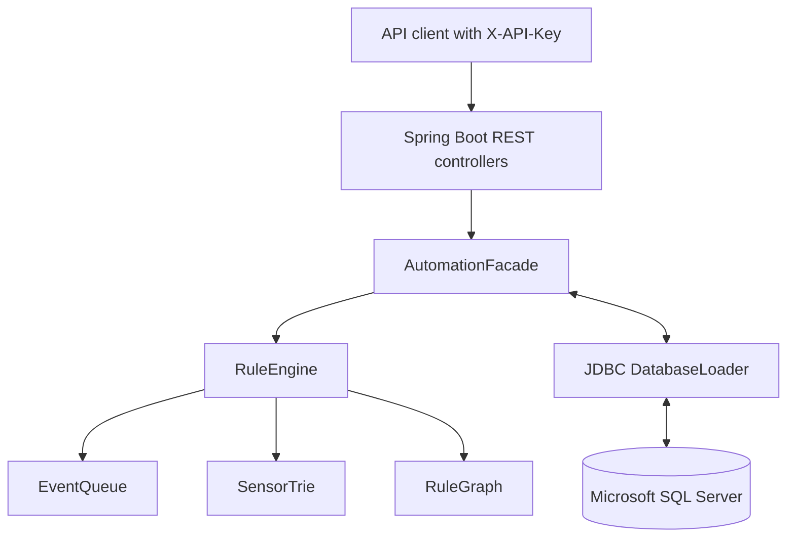

# Smart Home Automation — Database & Rule Engine

**A collaborative university project by Lilit Martirosyan and Mariam Vardanyan**  
Faculty of Computer Science and Applied Mathematics, French University in Armenia  
Originally developed for the Databases coursework (April 2026).

This repository contains a **database-backed smart home automation simulator** built with Java, Spring Boot, Microsoft SQL Server, and custom data structures. It models homes, rooms, devices, sensors, automation rules, event processing and execution logs. **It does not control physical IoT hardware.**

> **Team attribution:** This is a group project, not an individual/solo project. The team members are named from the original coursework report. Individual contribution ownership was not documented in the supplied materials, so this repository intentionally makes no claims about which member built which component. The repository cleanup and improvements are a later, AI-assisted revision of that original team work, for team review.

## Features

- Relational SQL Server database with primary/foreign keys, linked homes, rooms, devices and sensors.
- Sensor event queue with exact sensor-ID matching via a trie index.
- Rules with multiple conditions (logical AND), multiple actions, and graph-based chaining with cycle detection.
- Non-mutating rule preview using the same evaluation path as event processing.
- REST APIs for retrieving homes, rooms, rules, device state, dashboards and human-readable execution logs.
- Atomic database writes for simulated device-state changes + action logging.
- SQL views, indexes, stored procedures, dangerous-event trigger and example queries.
- Shared API key access gate and environment-only database credentials for **local development**.

## Tech stack

| Layer | Technology |
| --- | --- |
| Backend | Java 17+, Spring Boot 4.0.5, REST |
| Data | Microsoft SQL Server, JDBC, T-SQL |
| Algorithmic core | Custom linked queue, sensor trie, dependency graph |
| Tests | JUnit 5, standalone Java smoke test, GitHub Actions |
| Deployment | Local demonstration / prototype; no production hosting configuration |

## Architecture



**Processing path:** persist a sensor event once → enqueue → update in-memory sensor state → evaluate all conditions → plan actions → simulate state change in SQL Server and persist execution outcome. `SIMULATED` means the database operation succeeded, **not** that physical hardware responded.

## Repository structure

```text
smart-home-automation/
├── backend/               Spring Boot application and JUnit tests
├── database/              Fresh schema, demo seed, migration, views, triggers, procedures
├── docs/                  Architecture, API, setup, security and team credits
├── examples/              Sample requests
├── scripts/               Dependency-free core engine smoke tests
├── .github/workflows/     Unit-test CI
├── .env.example           Required local environment variable names (not real credentials)
└── README.md
```

## Quick start (Windows / SQL Server Management Studio)

**Prerequisites:** JDK 17+ (21 recommended), SQL Server with TCP enabled, SQL Server Management Studio, and an appropriate SQL Server login. Maven is accessed through the included wrapper. Windows instructions: [docs/SETUP_WINDOWS.md](docs/SETUP_WINDOWS.md).

1. Start SQL Server; use SSMS to run `database/00_create_database.sql` against `master`.
2. Select `smart_home` and run **in order** `01_schema.sql`, `02_seed_demo.sql`, `03_views.sql`, `04_indexes.sql`, `05_triggers.sql`, `06_procedures.sql`. `07_access_roles.sql` optionally creates a restricted database role for an externally provisioned SQL user.
3. Configure the 4 required environment variables based on [.env.example](.env.example): `SMART_HOME_DB_URL`, `SMART_HOME_DB_USER`, `SMART_HOME_DB_PASSWORD`, and `SMART_HOME_API_KEY` (16+ characters). The example JDBC certificate trust option is **local-development only**.
4. From `backend/`, run `mvnw.cmd test` and then `mvnw.cmd spring-boot:run` (PowerShell: `./mvnw.cmd ...`). Use `X-API-Key: <your key>` on all API requests except `/hello`.
5. Find real sensor IDs using `SELECT sensor_id, sensor_type FROM Sensor;` or your own database records. Call `POST /events`, followed by `POST /events/process` to simulate an event.

**Existing database:** Do **not** re-run `01_schema.sql`. Make a backup and review [`08_migrate_legacy.sql`](database/08_migrate_legacy.sql). Legacy type-only conditions must be mapped manually where more than one sensor of a type exists in the same home.

## Quick API example

```bash
# Export SMART_HOME_API_KEY separately; this example assumes a Unix-like shell.
curl -H "X-API-Key: $SMART_HOME_API_KEY" http://localhost:8080/rules

# Replace sensorId with a real ID from your local demo database.
curl -X POST http://localhost:8080/events \
  -H "X-API-Key: $SMART_HOME_API_KEY" \
  -H 'Content-Type: application/json' \
  -d '{"sensorId": 1, "value": 1}'

curl -X POST -H "X-API-Key: $SMART_HOME_API_KEY" http://localhost:8080/events/process
```

See [API examples](docs/API.md) and [example requests](examples/requests.http).

## Tests and verification

The algorithmic core can be tested without Maven or a SQL Server:

```bash
bash scripts/check-engine.sh
```

On Windows run `./scripts/check-engine.ps1` in PowerShell. Full JUnit tests: `cd backend && ./mvnw test` (or `./mvnw.cmd test` on Windows). CI runs both when GitHub Actions has network access to resolve Maven dependencies. **Full application startup and SQL integration still need testing against a real SQL Server** — see [testing notes](docs/TESTING.md).

## Important limitations

- The shared API key is a **demo access gate**, not real user identity, home ownership checks or role-based authorization. **Do not deploy this service on the public internet.**
- The simulator changes SQL `on_state` values; no MQTT, physical device adapters, frontend or external notification service is included.
- Dependency graph edges are currently stored in memory and do not survive application restart.
- Existing (legacy) rules with ambiguous sensor types require manual mapping using exact `sensor_id`.
- A dedicated database connection pool, integration tests, production-grade observability, and stronger transactional/event processing are future work.

For more information: [security](SECURITY.md), [architecture](docs/ARCHITECTURE.md), [limitations and follow-ups](docs/ROADMAP.md).

## Credits, provenance and license

**Original group:** Lilit Martirosyan and Mariam Vardanyan (per the supplied project report). See [CONTRIBUTORS.md](CONTRIBUTORS.md) for a team-first attribution policy. The original report also referenced an earlier [database repository](https://github.com/i23lilitmartirosyan/smart_home_database.git); this updated repository is prepared from the team's files and is not a claim of sole authorship.

**Later revision:** security cleanup, consistency fixes, demo seed, testing, API adjustments and documentation prepared with AI assistance for review by **both** team members. Change history: [CHANGELOG.md](CHANGELOG.md).

**License:** No open-source license has been selected by the team. A LICENSE file should be added **only after both contributors agree**. Without a license, default copyright restrictions apply; public visibility alone does not grant others reuse permission.
