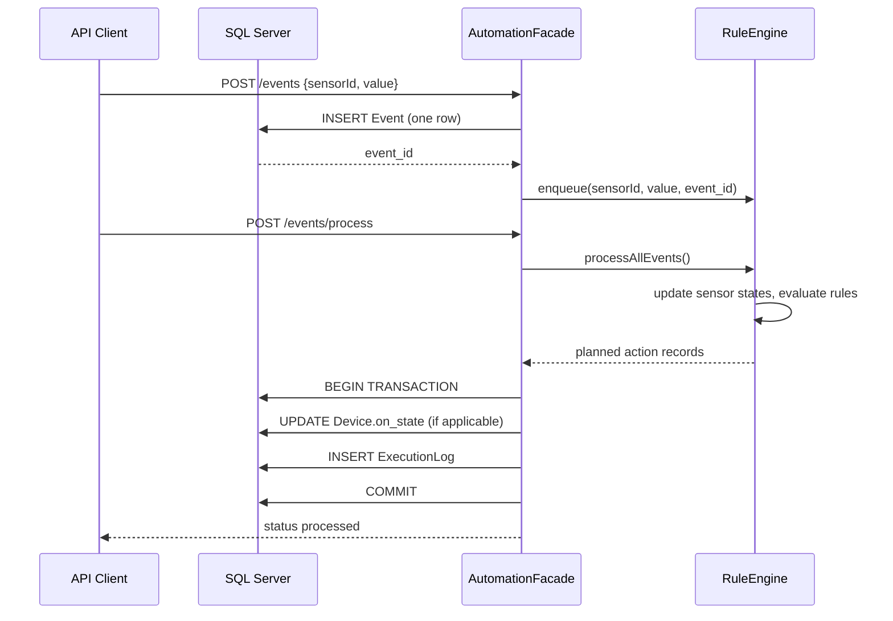
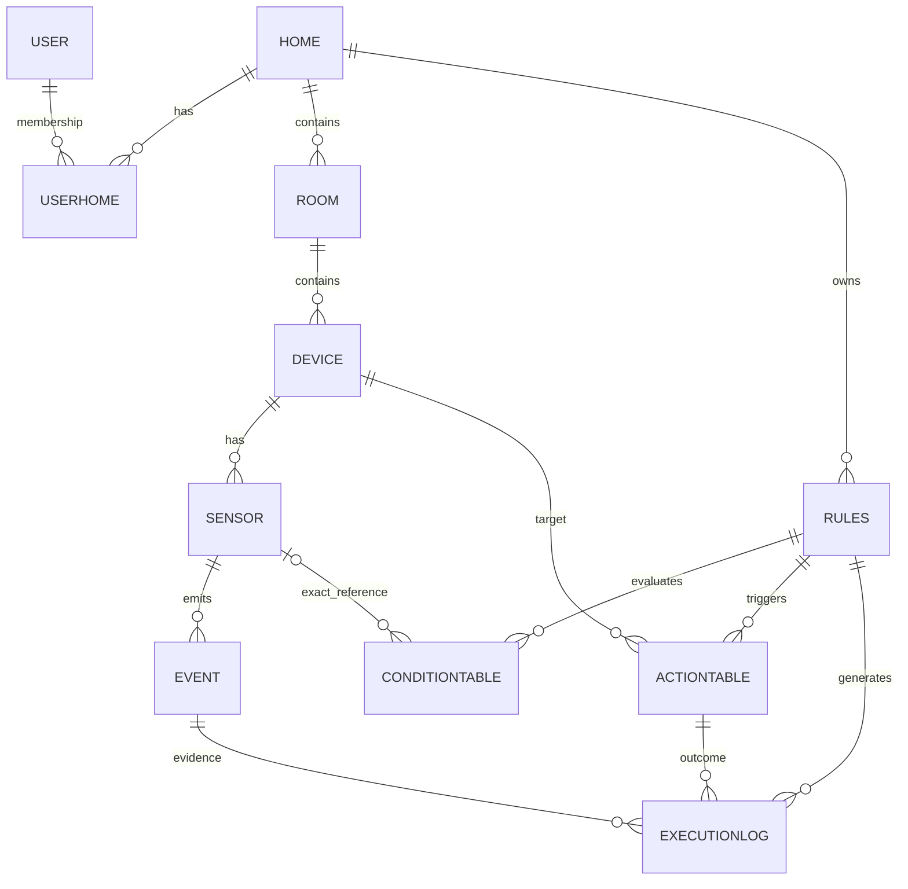

# System architecture

## Scope

The project implements the **database and simulated backend** portions of a smart home automation system. No actual sensor transport, cloud integration, mobile application, frontend, or hardware device driver is included. An API client injects sensor readings for testing.

## Components

**SensorTrie:** indexes rules by sensor ID so a reading evaluates only relevant rules; a rule can be indexed under multiple sensor IDs. **EventQueue:** a custom linked FIFO queue. **RuleGraph:** optional dependency edges with DFS-based cycle detection. **RuleEngine:** checks that **all** conditions have values and are satisfied; a preview uses an overlay state but does not persist or mutate current values. **AutomationFacade:** coordinates persistence and planning and applies simulated action results.

## Database hierarchy

The authoritative SQL script is `database/01_schema.sql`. Legacy conditions stored only a broad `attribute` such as `motion`; the improved schema adds `sensor_id` to remove ambiguity. The original rule-table decomposition is preserved.

## State and execution semantics

`Device.is_active` means *available / allowed for automation*, whereas `Device.on_state` is the simulated *on/off* state. `ExecutionLog.status = 'SIMULATED'` means the database transaction succeeded; it must not be interpreted as a real device acknowledgment. `send_alert` is logged, but the system does **not** deliver real SMS, push or email alerts. Dangerous-event triggers insert records into `AlertLog` only.

## Known engineering trade-offs

- Condition logic is AND; legacy `logical_operator` and `group_id` columns are reserved but **not implemented as boolean expression trees**.
- Graph edges are in-memory only; no schema stores dependencies.
- Each event is persisted before processing; an unexpected crash can leave stored events without actions. There is no replay worker or durable message broker.
- Action execution failure is reflected in in-memory logs, but a failed database transaction might not produce a persisted failure record.
- Facade operations are synchronized within one JVM; this does not provide distributed synchronization or multi-instance safety.
- SQL views, triggers and procedures remain useful but full SQL integration and performance have not been benchmarked.
